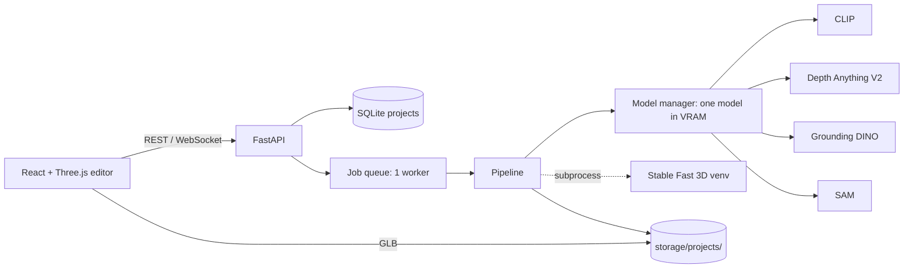

# Architecture



The frontend is a single-page React app. A small imperative engine (`frontend/src/viewer/SceneViewer.ts`) owns the Three.js renderer, cameras, controls, picking and materials; React components drive it through methods such as `setShading`, `setVisible` and `setGroupTransform`.

The backend is FastAPI. Uploads are validated by content, stored under a random 32-hex project id, and recorded in SQLite. Generation requests go into a queue served by one worker thread, so only one reconstruction uses the GPU at a time. The worker publishes stage, progress and log lines into an in-memory job state; clients read it over `GET /status` or the WebSocket, which pushes each change. Jobs that were running when the server stopped are marked failed on the next start.

The model manager registers each network with a loader. `acquire()` evicts every other resident model and calls `torch.cuda.empty_cache()` before loading, so peak VRAM is one model plus activations. Load failures are turned into readable messages (gated repo, offline, out of memory) and the pipeline falls back.

Stable Fast 3D has native dependencies that conflict with the main environment and experimental Windows support, so it runs as a subprocess in its own virtual environment. SpatialAI unloads all its own models first, hands it an RGBA crop, and fits the returned GLB to the observed object.

## Storage layout

```
storage/
  spatialai.db
  projects/<id>/
    input/original.jpg
    work/                   temporary (Stable Fast 3D inputs/outputs)
    output/
      scene.glb  scene_gltf.zip  metadata.json  report.json
      depth.png  depth16.png  depth.npy  working.png  inpainted.png
      masks/*.png
      assets/obj_XX_<label>.glb
```

## Security

Uploads are checked by decoding them (not by extension) and limited by size, pixel count and format. Files are stored under generated ids, never under user-supplied names. Project ids must match `^[a-f0-9]{32}$`; asset downloads are resolved only through the allow-list in `metadata.json` and a containment check. Unhandled errors return a generic message without paths or stack traces. The API binds to 127.0.0.1 by default and has no authentication, so don't expose it to a network.
